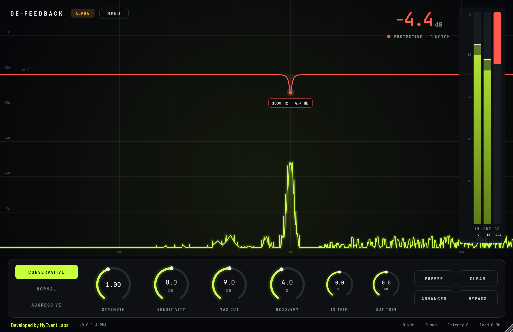
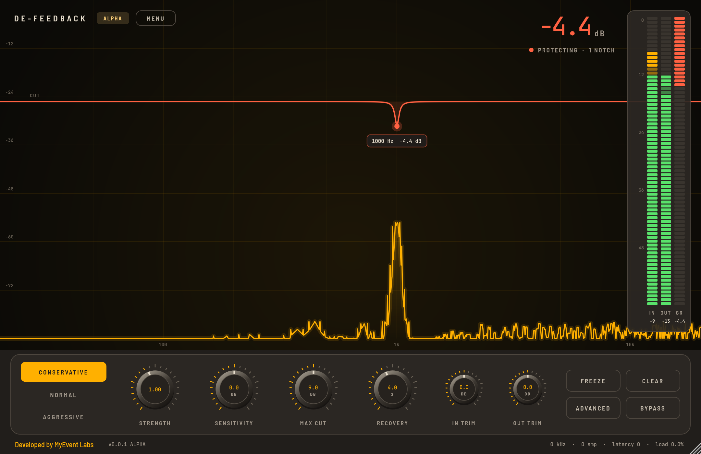
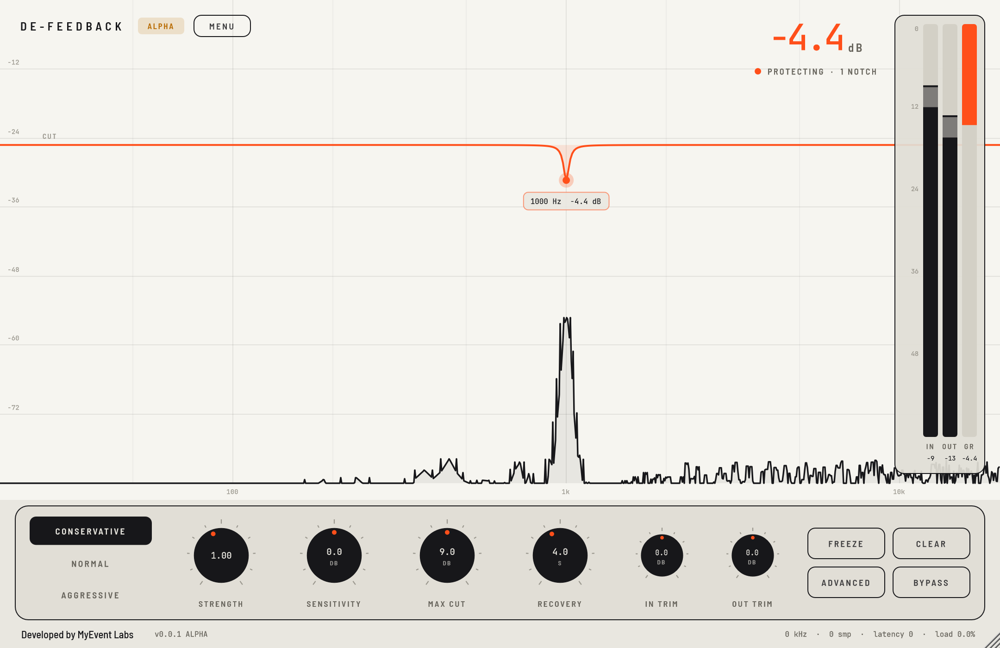

# MyEvent Labs De-Feedback

**MyEvent Labs De-Feedback** is an experimental adaptive feedback-control plugin
for live sound. The v0.0.1 alpha detects persistent narrow-band instability and
applies a controlled bank of narrow adaptive peaking filters (notches) with **no
intentional lookahead**.

> **Alpha software:** Test under controlled conditions before any live event.
> This release is not yet validated for show-critical use and does not replace
> proper system design, gain structure or system tuning.

De-Feedback v0.0.1 is a **deterministic signal processor**. It is not
AI-powered, makes **no guaranteed gain-before-feedback improvement claim**, and
is not equivalent to any commercial product. See
[`docs/ALPHA_LIMITATIONS.md`](docs/ALPHA_LIMITATIONS.md).

## Formats

| Platform | Formats |
|----------|---------|
| Windows  | VST3, Standalone |
| macOS    | VST3, AU v2, Standalone |

- Mono and stereo operation.
- Sample rates 44.1 / 48 / 88.2 / 96 kHz (and the rate the host reports).
- Block sizes 32 – 1024 samples.

## Features (v0.0.1)

- Automatic detection of likely feedback from persistent narrow-band energy.
- Up to 12 adaptive notch filters per channel, or safely linked for stereo.
- Conservative / Normal / Aggressive protection modes.
- Strength, Sensitivity, Max Cut and Recovery controls.
- Freeze (hold detected notches) and Clear all notches.
- Click-free bypass and click-free notch add/remove.
- Input/output trims, input/output peak + RMS + peak-hold metering, a
gain-reduction meter and a real-time spectrum with a live cut curve and a tag
per active notch.
- Versioned state/preset recall with safe fallback on malformed state.
- Modern, resizable interface (900x600 minimum, 1600x1000 maximum).

## Interface



The analyser fills the window: signal in lime, and every cut the plugin makes in
coral, drawn as a dip in the CUT curve with a tag showing its frequency and
depth. A large read-out top right shows the deepest cut being applied right now
(or LISTENING / BYPASSED). In, out and gain-reduction meters with peak hold
float on the right. A dock along the bottom holds the protection mode, Strength,
Sensitivity, Max Cut, Recovery, in/out trim, and Freeze, Clear, Advanced and
Bypass. Advanced opens a drawer (frequency range, notch count, Q bias, linked
stereo). Presets and About live under MENU. The footer carries the MyEvent Labs
link, the version and engine status. Double-click a knob to reset it.

Three skins share this layout, chosen under MENU > Skin and remembered per user
on each computer: **Scope** (default, shown above), **Console** (metal knobs,
LED ladder meters, amber trace) and **Instrument** (ink on paper, orange cuts).

| Console | Instrument |
| --- | --- |
|  |  |

More captures in [`docs/screenshots/`](docs/screenshots): idle at 960x640, the
minimum 900x600 layout, and the Advanced drawer open.

## Install (alpha)

Windows:
```
VST3:        C:\Program Files\Common Files\VST3\
Standalone:  run the .exe anywhere
```

macOS:
```
VST3:        /Library/Audio/Plug-Ins/VST3/
AU v2:       /Library/Audio/Plug-Ins/Components/
Standalone:  /Applications
```

The macOS alpha is **unsigned**. Gatekeeper will block it until you right-click →
Open, or remove the quarantine attribute on a build you trust:
`xattr -dr com.apple.quarantine "/Path/To/Plugin.vst3"`. Do not lower system
security settings globally.

## Build from source

Requirements: CMake 3.22+, a C++20 compiler (MSVC 2022 on Windows, Xcode on
macOS), Ninja or the platform generator. JUCE 8 is fetched and pinned by CMake.

```bash
cmake -S . -B build -DCMAKE_BUILD_TYPE=Release
cmake --build build
```

Offline / air-gapped builds can point at a local JUCE checkout:

```bash
cmake -S . -B build -DDE_FEEDBACK_JUCE_PATH=/path/to/JUCE
```

### Tests and tools

```bash
cmake -S . -B build -DDE_FEEDBACK_BUILD_TESTS=ON -DDE_FEEDBACK_BUILD_TOOLS=ON
cmake --build build
ctest --test-dir build --output-on-failure      # or run the tests binary directly
```

The offline tools are `defeedback_tests` (unit + DSP regression + a headless
processor suite), `defeedback_quality` (an objective scenario harness; `--gate`
fails on a regression), `defeedback_analyze` (artefact/IMD analysis),
`defeedback_signal_generator` (test fixtures), `defeedback_benchmark` (CPU) and
`defeedback_screenshot` (offscreen UI captures to PNG).

## Licence

De-Feedback v0.0.1-alpha is distributed under the **GNU General Public License
v3.0**. This is required because the project uses JUCE under its GPLv3 option.
See [`LICENSE`](LICENSE) and [`THIRD_PARTY_NOTICES.md`](THIRD_PARTY_NOTICES.md).

If the project is ever relicensed to a proprietary licence, a JUCE commercial
licence must be purchased first. That is a documented release blocker.

## Documentation

- [`docs/ARCHITECTURE.md`](docs/ARCHITECTURE.md)
- [`docs/DSP_DESIGN.md`](docs/DSP_DESIGN.md)
- [`docs/TEST_PLAN.md`](docs/TEST_PLAN.md)
- [`docs/ALPHA_LIMITATIONS.md`](docs/ALPHA_LIMITATIONS.md)
- [`CHANGELOG.md`](CHANGELOG.md)
- [`SECURITY.md`](SECURITY.md)
